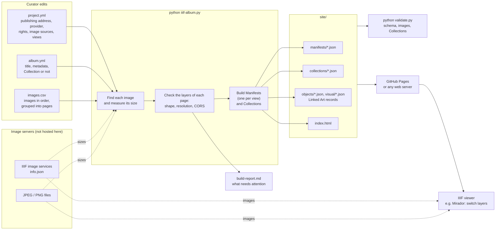

# IIIF Manifests for layered photo albums

[](https://doi.org/10.5281/zenodo.23794320)

This repository turns a spreadsheet of images into [IIIF Presentation API 3.0](https://iiif.io/api/presentation/3.0/) Manifests (and, if wanted, Collections) for photo albums that were digitised in layers: the same page with and without its protective interleaf, with an insert, with its cord, and so on. In a IIIF viewer such as Mirador, the layers of a page can be switched on the same Canvas.

It does not host images. You point to images that are already online (on a IIIF image server, or as plain JPEG/PNG files); the tool finds their sizes, builds the Manifests, checks them and writes them as JSON files that can be published on GitHub Pages or any web server.

The two albums of the SGV_10 Kreis Family Collection, SGV_10A_00031 and SGV_10A_00050, are the worked examples.

## How it works



The files involved:

```
project.yml                  shared settings: publishing address, provider, rights, image sources
albums/
  SGV_10A_00031/
    album.yml                title, description, metadata, Collection or not
    images.csv               one line per image, in album order
site/                        generated, laid out as published
  manifests/SGV_10A_00031_layers.json
  collections/SGV_10A_00031.json
  objects/SGV_10A_00031.json   Linked Art record of the album (optional)
  visual/SGV_10A_00031.json    Linked Art record of what its photographs show (optional)
  index.html                 list of everything, with links to viewers
build-report.md              generated: what needs attention
```

1. Describe the album in `album.yml` and list its images in `images.csv`.
2. Run `python iiif-album.py`, or push to GitHub and let the workflow run it.
3. Read the report: images that could not be found, sizes that were assumed, layers whose shape does not match.
4. Publish the `site/` folder.

## Adding an album

```bash
python new-album.py MY_ALBUM --images my-list.txt --layer-pattern _with_
```

`my-list.txt` lists the images of the album in order, one per line, as file names or URLs. `--layer-pattern` (optional) groups images into pages from their names: `012_with_insert.jpg` becomes a layer of `012.jpg`. The command creates `albums/MY_ALBUM/album.yml` and `images.csv`, which you then complete. You can also write both files yourself, e.g. by copying an example album.

### images.csv

Edit it in any spreadsheet program (comma, semicolon or tab separated, saved as UTF-8). Only `image` is required.

| Column | Meaning |
| --- | --- |
| `image` | The image: a file name looked up on the image sources of `project.yml`, or a URL. A URL can be a IIIF image service, its `info.json`, any IIIF image request (as copied from a viewer), or a JPEG/PNG file. |
| `page` | Images with the same `page` are the layers of one Canvas; the first one is shown by default. Empty: the image is a page of its own. |
| `label` | Label of the Canvas (taken from the first image of the page). Empty: the file name. |
| `layer` | Name of the layer in the viewer's layer menu. Empty: the label. |
| `tags` | Free words, e.g. `loose` for loose photographs, used to leave images out of some Manifests. |

Example, from SGV_10A_00031:

```csv
image,page,label,layer,tags
SGV_10A_00031_005.tif,005,,005,
SGV_10A_00031_005_mit_Schutz.tif,005,,005_mit_Schutz,
SGV_10A_00031_005_mit_Zusatz.tif,005,,005_mit_Zusatz,
SGV_10A_00031_09861_r.tif,09861_r,,09861_r,loose
```

The order of the lines is the order of the Canvases. Canvas ids are numbered by position (`.../canvas/p5`), so inserting or removing a line later changes what the following ids point to; the build warns when this happens to a Manifest that was already generated.

### album.yml

```yaml
label: Album SGV_10A_00050
metadata:            # label: value pairs; empty values are left out
  Title: "[Gebundenes Album mit Rosenmuster mit Fotografien eines Patenkindes]"
  Identifier: SGV_10A_00050
  Year/Period: "1949"
collection:          # leave out if no Collection is wanted
  label: IIIF Collection of the SGV_10A_00050 Photo Album
```

Any setting of `project.yml` (summary, rights, provider, views, ...) can be repeated in `album.yml` to change it for that album only. `thumbnail` can name an image of `images.csv`; otherwise the first image served is used.

## Image sizes: assumptions and warnings

Curators often do not know the pixel size of the images, and do not need to. The build reads it:

- from `info.json` for IIIF images (the Image API version, 2 or 3, is detected there too; `maxArea` limits of Image API 3.0 servers are applied);
- from the first bytes of the file for JPEG/PNG images;
- from `known_dimensions` (`recorded_dimensions.json`) for images that are not served yet.

If an image cannot be measured, its body is written without a size and its Canvas takes the size of another image of the same page, or else the usual size of the album. The report says which.

Each layer is compared with the first image of its page:

- **Different shape** (aspect ratio differs by more than 2 %): a warning. The viewer stretches every layer to the Canvas, so this layer will look distorted when switching.
- **Different resolution** (more than 2× larger or smaller): a note. Nothing breaks, but zooming in shows the layers with unequal sharpness.

Both thresholds are set under `checks` in `project.yml`. The build also warns when an image server does not allow other websites to load its images (no CORS header), since viewers then cannot show them.

## Views: which Manifests are made

`views` in `project.yml` lists the Manifests made from each album. Without it, one Manifest per album shows each page with its layers. The examples make three:

| Manifest | `canvases` | Content |
| --- | --- | --- |
| `{album}` | `images` | All scans, each image on its own Canvas (`individuals`) |
| `{album}_paged` | `pages` | One Canvas per page with its first image, without the images tagged `loose` (`paged`) |
| `{album}_layers` | `layers` | One Canvas per page, its images as a `Choice` of layers (`paged`) |

## Collections

- **Per album**: add a `collection` entry to `album.yml`. The Collection `collections/{album}.json` lists the Manifests of the album.
- **For the whole project**: uncomment `collection` in `project.yml`, with an `id` and a `label`. It lists the Collection of each album that has one, otherwise the album's Manifests. It is only rewritten when all albums are built, so that a failing album does not drop out of it.

## Linked Art

A Manifest describes how an album is presented; a [Linked Art](https://linked.art/) record describes what the album is, as a physical object. For each album with a `linked_art` entry in its `album.yml`, the build writes a record that follows the [Linked Art API 1.0 Object endpoint](https://linked.art/api/1.0/endpoint/physical_object/) to `objects/{album}.json`, published as `{base_url}/objects/{album}.json`:

```yaml
linked_art:
  label: Album 31 (SGV_10A_00031)          # primary name; default: the album label
  language: de                             # of title and description: de, en, fr, it, es
  classified_as:                           # Getty AAT terms
    - id: http://vocab.getty.edu/aat/300026695
      label: photo album
      type_of_work: true                   # marks the term as the type of work
  produced:                                # optional; a date alone is read as a whole day
    begin: "1926-01-01T00:00:00Z"
    end: "1928-12-31T23:59:59Z"
  # id: https://example.org/object/...     # optional: use an existing record instead
```

Most of the record is taken from what the Manifests already say, so it is not entered twice:

| Linked Art | Taken from | Getty AAT |
| --- | --- | --- |
| `identified_by` Name (primary name) | `linked_art.label`, else the album label | Primary Name 300404670 |
| `identified_by` Name (title) | metadata `Title`, in `language` | Display Title 300404669 |
| `identified_by` Identifier | album id, assigned by the custodian | Accession Number 300312355 |
| `classified_as` | `linked_art.classified_as` | e.g. photo album 300026695, with Type of Work 300435443 |
| `referred_to_by` description | metadata `Description`, in `language` | Description 300435416, Brief Text 300418049 |
| `referred_to_by` credit statement | `attribution` | Credit Statement 300026687, Brief Text 300418049 |
| `produced_by` time span | `linked_art.produced`, displayed as metadata `Year/Period` | Display Title 300404669 |
| `produced_by.part` | `linked_art.makers`, each with its role as label | |
| `shows` VisualItem | `linked_art.places`: a record `visual/{album}.json` that `represents` them | |
| `current_custodian` Group | `provider` | |
| `current_owner` Group | `linked_art.owner` | |
| `member_of` Set | `linked_art.collection` | |
| `subject_of` | every Manifest of the album, as in the [Linked Art pattern for IIIF Manifests](https://linked.art/model/digital/) | |

`title`, `description`, `credit` and `custodian` can be set in `linked_art` to replace these values; an empty value leaves the property out.

Owners, makers, places and the collection are references to other entities, and Linked Art requires each reference to have a URI. Give them as `{id, label}`, with an id from an authority file (GND for people and organisations, Getty TGN for places, or Wikidata); the build stops with a message when one is missing. For SGV_10A_00031, the maker (Papyrus AG, Basel) and the places come from its Memobase records. Its former owner, Walter Kreis, has no authority record yet, so he is only named in the description.

Every Manifest of the album, and its Collection, link back to the record with a `seeAlso` (`type: Dataset`, `format: application/ld+json`, Linked Art profile). With `id`, no record is written: the `seeAlso` points to that existing record, e.g. one published by the archive. Without `linked_art`, nothing changes in the Manifests.

Left out on purpose:

- The licence (`rights`) concerns the digitised images, not the album; Linked Art attaches such rights to the images.
- Former owners, the place of production, materials and dimensions need authority records or vocabulary choices by the curators. They would go in `changed_ownership_through`, `produced_by.took_place_at`, `made_of` and `dimension`.

## Image sources

Images given by file name are looked up on the `image_sources` of `project.yml`, in order; the first one whose `info.json` answers is used. In a source's `service`, `{name}` is the file name without extension and `{file}` the file name; `rewrite` adapts the name to one source. Images given by URL are used as given.

Images that no source serves yet keep their place at the `pending` address with their recorded size, so they display as soon as they are served there. Without `pending`, an image that cannot be found stops the build of its album and nothing is written for it.

For the examples:

| Source | Status | Image API | Notes |
| --- | --- | --- | --- |
| `memobase` | enabled | 2.x | Memobase (Memoriav) media service. `SGV_10A_00031_005` becomes `sgv-002-SGV_10A_00031_005-1`; loose photographs such as `SGV_10A_00031_09861_r` become `sgv-002-SGV_10P_09861_r-1`. Derivatives with a long side of 2400 px. |
| `self_hosted` | not set | 3.0 | Placeholder for the full resolution files requested from the EKWS. Set its `service` (and `pending`) once they are served. |
| `pia_cantaloupe` | disabled | 3.0 | Legacy PIA server (`sipi.participatory-archives.ch`), reachable only via VPN since 2026; also the current `pending` address. |

`requiredStatement` credits the `attribution` of `project.yml` and names the labelled image sources actually used.

## Running

```bash
python -m venv venv
source venv/bin/activate
pip install -r requirements.txt
python iiif-album.py                     # all albums
python iiif-album.py SGV_10A_00050       # a single album
python validate.py                       # check the generated Manifests and Collections
python validate.py --url                 # check the published versions
```

`iiif-album.py` exits with an error when an album could not be built; its report is in `build-report.md`.

On Python 3.12 and later, `iiif-prezi3` 1.x pins a Pillow version that has no wheel and fails to build. Use Python 3.11, or install a recent Pillow wheel first and then `pip install --no-deps "iiif-prezi3<2" "pydantic<2" requests jsonschema PyYAML`.

`validate.py` runs four separate checks, because the IIIF Presentation validator checks schema conformance only:

1. Schema: the [IIIF Presentation validator](https://presentation-validator.iiif.io/) (target `okay: 1`). Local files are posted to it; files larger than its request limit are checked against the validator's JSON Schema locally.
2. Images: every image body, thumbnail and service `info.json` answers with HTTP 200 and sends a CORS header. With `--images-warn`, images that do not answer are listed without failing (useful while images are pending).
3. Collections: every item of the Collections is among the generated files.
4. Linked Art: every record in `objects/` (and `visual/`) has the Linked Art `@context`, is a `HumanMadeObject` (a `VisualItem`) whose `id` is its published address, the objects point only to generated Manifests, and every `seeAlso` and `shows` has its record. This check uses local files only.

Whether the chosen layers are meaningful is not checked automatically.

## Publishing

The `site/` folder is laid out as published: `{base_url}/manifests/{id}.json` and `{base_url}/collections/{id}.json`. Once a Manifest has been cited, keep `base_url` and the album and view names unchanged.

- **GitHub Pages**: leave `base_url` empty in `project.yml` (the ids then use `https://<owner>.github.io/<repository>`), set Settings > Pages > Source to *GitHub Actions*, and add the repository variable `DEPLOY_PAGES` = `true`. The workflow in `.github/workflows/build.yml` then builds, validates and publishes on every push; its report appears on the run's summary page.
- **Another web server**: set `base_url` and copy the contents of `site/` there. The server must send `Access-Control-Allow-Origin: *` with the JSON files.

Without `DEPLOY_PAGES`, the workflow only builds and validates, as for this repository.

### The examples

The SGV_10 Manifests are published at `https://julsraemy.ch/hostiiing` (the `site/` folder is copied there).

- _All scans_: all digitised pages, with scans of pages with protective film and loose photographs: https://julsraemy.ch/hostiiing/manifests/SGV_10A_00031.json and https://julsraemy.ch/hostiiing/manifests/SGV_10A_00050.json
- _Paged_: tagged with the `paged` behavior, only the digitised pages, i.e. without protective film and loose photographs: https://julsraemy.ch/hostiiing/manifests/SGV_10A_00031_paged.json and https://julsraemy.ch/hostiiing/manifests/SGV_10A_00050_paged.json
- _Layers_: all digitised pages, the scans with protective film as layers of the relevant Canvases: https://julsraemy.ch/hostiiing/manifests/SGV_10A_00031_layers.json and https://julsraemy.ch/hostiiing/manifests/SGV_10A_00050_layers.json

Collections: https://julsraemy.ch/hostiiing/collections/SGV_10A_00031.json and https://julsraemy.ch/hostiiing/collections/SGV_10A_00050.json

While the Manifests are rebuilt, `notice` in `project.yml` adds an "Under construction" notice with the image coverage to the Manifests and Collections. Set `enabled: false` and rebuild to remove it.

### Known gaps (October 2026)

Memobase holds only the default capture of pages that carry photographs. None of the variants (`_mit_Schutz`, `_mit_Zusatz`, `_mit_Kordel`, `_mit_Zusatzmaterial`) are on Memobase, so the layers of the layers Manifests do not display yet.

- SGV_10A_00031: 35 of 128 images served. Missing: pages 032 to 081 (the last third of the album, left empty), all variants, and the verso of the loose photograph 09861.
- SGV_10A_00050: 24 of 71 images served. Missing: the even pages 004 to 022, every page from 023 to 038 (odd pages with photographs included), and all variants.

These gaps are expected to close once the EKWS files are served through `self_hosted`.

## Tools for the examples

- `tools/check_memobase.py`: probes Memobase for every image of the albums and writes `memobase_check.csv`.
- `tools/record_dimensions.py`: collects the image sizes of all Manifests in the git history into `recorded_dimensions.json`.

## Citation

[](https://doi.org/10.5281/zenodo.23794320)

If you use this software, please cite it as below (see also [CITATION.cff](CITATION.cff)):

> Raemy, J. A. (2026). *iiif-photoalbum* (Version 1.1.0) [Computer software]. Zenodo. https://doi.org/10.5281/zenodo.23794320

```bibtex
@software{raemy_iiif_photoalbum_2026,
  author    = {Raemy, Julien Antoine},
  title     = {iiif-photoalbum},
  version   = {1.1.0},
  year      = {2026},
  publisher = {Zenodo},
  doi       = {10.5281/zenodo.23794320},
  url       = {https://doi.org/10.5281/zenodo.23794320}
}
```

This DOI always leads to the latest version. The DOI of each version is listed on [Zenodo](https://doi.org/10.5281/zenodo.23794320); version 1.0.0 is https://doi.org/10.5281/zenodo.23794321.
